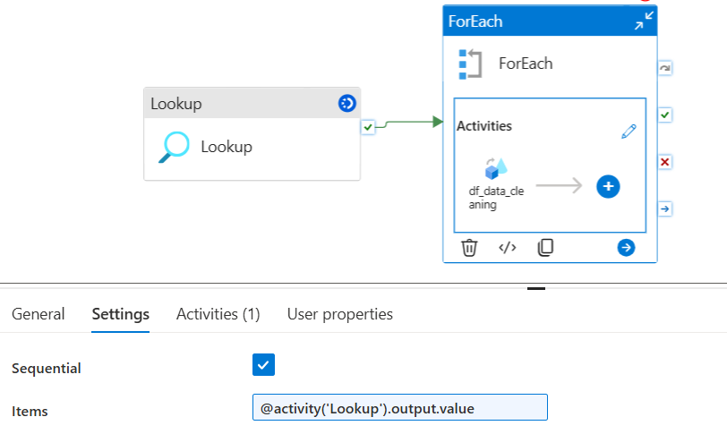
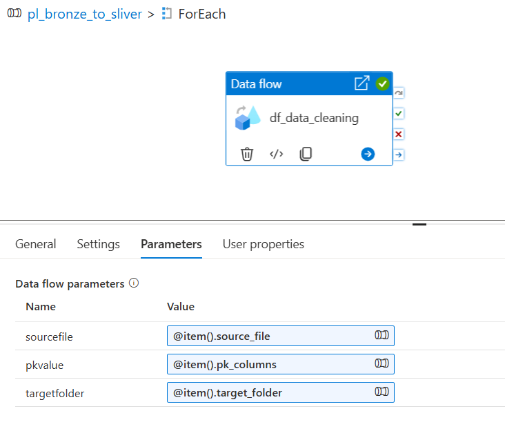

# Bronze-to-Silver Data Transformation (Cleaning the Data)

**Summary:** Standardized the initial handling of source data, trimmed whitespace, handled null and NA values, converted columns to the appropriate data types, added audit columns, and validated primary keys by handling nulls and duplicates. Finally, loaded the cleaned data into the Silver layer in Delta format.

## 1. Dynamic Pipeline Configuration and File Processing

- Created a pipeline named `pl_bronze_to_silver` in Azure Synapse Analytics to dynamically process and clean files from the Bronze layer.
- Added a **Lookup activity** to read file names and primary key mappings from the configuration file.
- Used a **ForEach activity** to iterate through the configured file entries.



## 2. Data Flow Configuration

- Created a Data Flow named `df_data_cleaning` with three parameters: `sourceFile`, `pkValue`, and `targetFolder`.
- Configured the dataflow parameters to dynamically read from for-each values using parameters.




```
source → cleanstrings → casttypes → addaudit → validate ─┬─ valid   → dedupe (Aggregate) → select → silversink
                                                         └─ Invalid → rejectsink
```

### 1 Source
- Source type: **Inline**, dataset type DelimitedText, linked service = ADLS Gen2.
- Source options: container `bronze`, file name = `$sourcefile`, **First row as header** ✅.
- No imported projection. Inline sources have no fixed schema, so every column arrives as **string**. This is how we follow the brief's "avoid inferSchema": nothing is guessed, we set types ourselves.
- Debug value: `'customers.csv'` (with quotes, because parameter values are expressions).

### 2 cleanstrings (Derived column, column pattern)
| Matches | Name | Value |
|---|---|---|
| `type == 'string'` | `$$` | `iif(isNull($$) \|\| trim($$) == '' \|\| upper(trim($$)) == 'NA' \|\| upper(trim($$)) == 'NULL', toString(null()), trim($$))` |

Trims every text value and turns blank / "NA" / "null" into real nulls. `upper()` is only used for the comparison, so the original letter case is kept.

### 3 casttypes (Derived column, one column pattern per rule)
| Matches | Name | Value | Result |
|---|---|---|---|
| `endsWith(name,'_date')` | `$$` | `toDate(toString($$),'yyyy-MM-dd')` | date |
| `name=='balance' \|\| endsWith(name,'_amount')` | `$$` | `toDecimal(toString($$),18,2)` | decimal(18,2) |
| `name=='interest_rate'` | `$$` | `toDecimal(toString($$),5,2)` | decimal(5,2) (5.5 = 5.5%) |
| `name=='loan_term'` | `$$` | `toInteger(toString($$))` | integer (months: 24/36/48/60) |
| `endsWith(name,'_type') \|\| name=='state'` | `$$` | `upper(toString($$))` | string, upper case |

Not cast on purpose:
- `*_id` and `zip` stay **string**: they are labels, not quantities, and storing them as numbers would drop leading zeros (`02134` → `2134`).
- `first_name`, `last_name`, `address`, `city` stay as trimmed strings (decision: no case change for names).

`toString($$)` is needed because, at design time, the editor doesn't know the columns' types; it removes the "Type mismatch" error.

### 4 addaudit (Derived column, normal columns)
| Column | Value |
|---|---|
| `load_timestamp` | `currentTimestamp()` |
| `source_file` | `$sourcefile` |

These are **lineage** columns: which run and which file brought a row in.
Record-history columns (`created_date`, `updated_date`, `created_by`, `updated_by`) are **not** added here; they belong in the SQL table during the SCD-1 load, because silver is overwritten every run.

### 5 validate (Conditional split, first matching condition)
| Stream | Condition |
|---|---|
| `valid` | `!isNull(toString(byName($pkvalue)))` |
| `Invalid` | default (everything else) |

`byName($pkvalue)` looks up the column whose name is stored in the parameter , which is what makes one rule work for all 5 files.

### 6 dedupe (Aggregate) + select
- Group by: computed column `pk` = `byName($pkvalue)`
- Aggregates: column pattern, matches `name != 'pk'`, name `$$`, value `first($$)`
- Select: drop the helper column `pk`

Result: one row per primary key (like `drop_duplicates(subset=pk, keep='first')`).

### 7 Sinks
| Sink | Stream | Type | Container / folder | Table action |
|---|---|---|---|---|
| `silversink` | valid (after select) | Inline Delta | `silver` / `$targetfolder` | Overwrite |
| `rejectsink` | Invalid | Inline Delta | `silver` / `concat('_rejected/', $targetfolder)` | Overwrite |

Each table gets its own folder because a **Delta table is a folder**: parquet part files plus a `_delta_log` transaction log. Sharing a folder would merge tables into one broken table.


---
