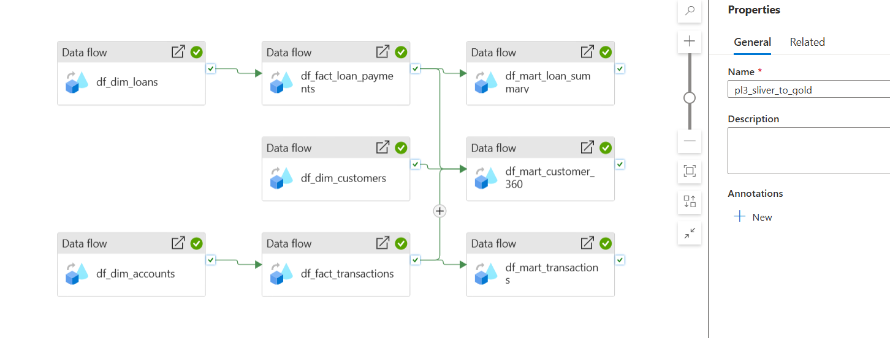
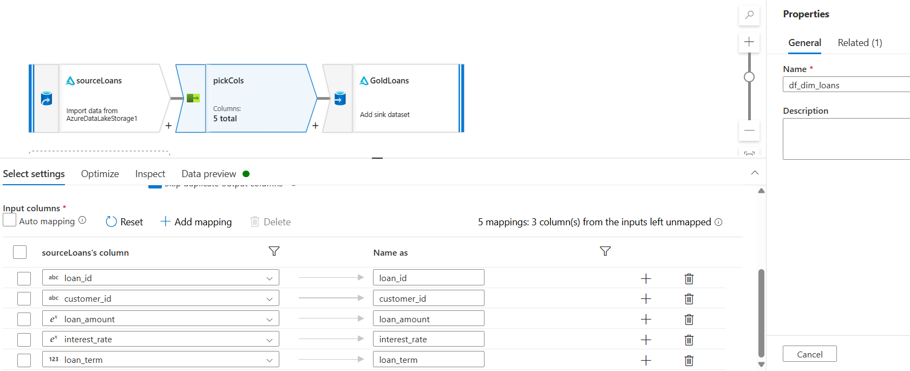
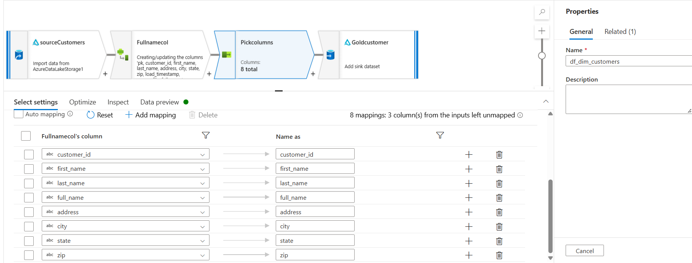
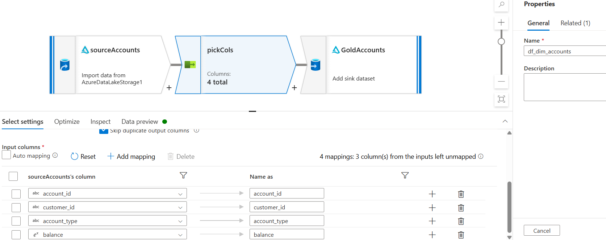
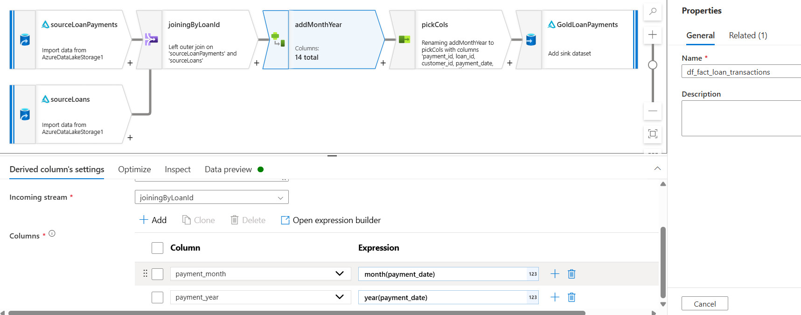
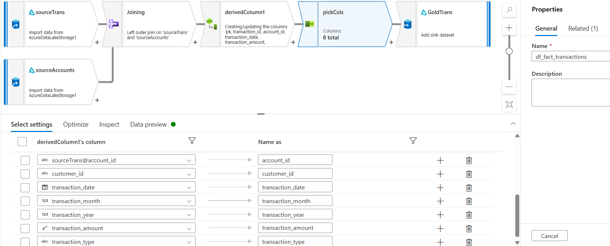
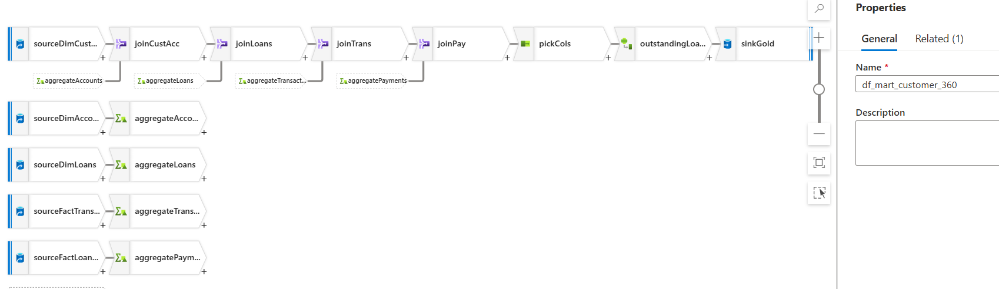
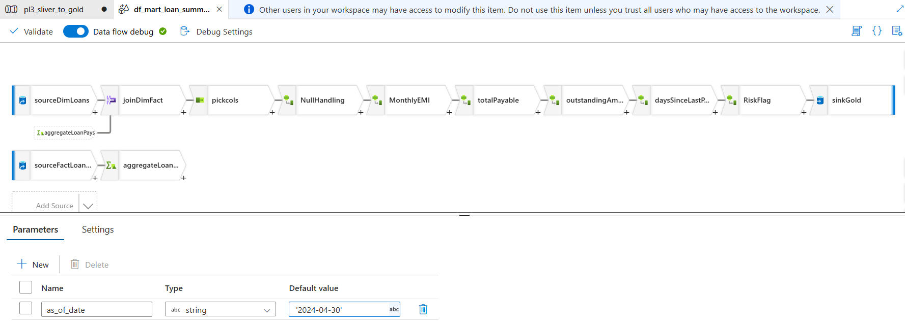
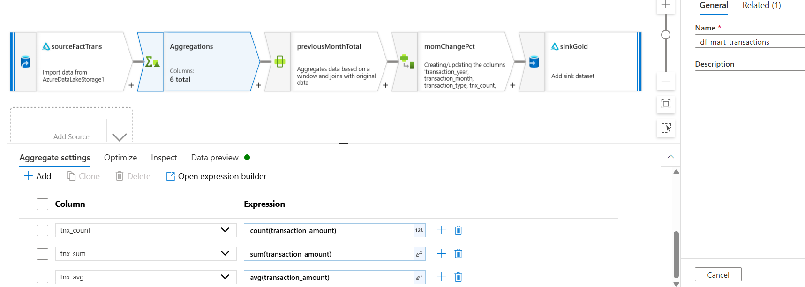

# Sliver-to-Gold Business Requirements (Cleaning the Data)

## Summary
- p3 turns the 5 clean silver tables into a **star schema** (3 dimensions + 2 facts) and **3 business marts**, all saved as Delta tables in the `gold` container.
- Dimensions describe *who/what* (customers, accounts, loans), facts record *events* (transactions, payments), and marts answer specific business questions with ready-made numbers.
- Activities are chained with **On success** dependency arrows, so each table only runs after the tables it reads from have finished.

---

## 1. Why a gold layer?
Silver has one clean table per source file. That's great for accuracy, but a business user can't easily answer "who are our best customers?" from it. Gold reshapes the data around **business questions**:

| Part | What it is | Example |
|---|---|---|
| Dimensions | Descriptions of things | A customer's name and city |
| Facts | Events that happened | A deposit of 500 on 2024-03-15 |
| Marts | Pre-calculated answers | Each customer's total balance and segment |

---

## 2. Pipeline p3: order of activities

```
dim_customer ─────────────────────────────┐
dim_account  → fact_transactions   ──┬────┼→ mart_customer_360
                                     │    │
                                     └────┼→ mart_monthly_transactions
dim_loan     → fact_loan_payments  ──┬────┘
                                     └───→ mart_loan_summary
```

- The 3 dims start **in parallel** (nothing depends on them).
- Each fact waits only for the dim it joins to.
- When an activity has **several incoming arrows**, it waits until **all** of them succeed. `mart_customer_360` has arrows from `dim_customer`, `fact_transactions` and `fact_loan_payments`. That's enough, because the other dims already ran before the facts.

All sinks: **Inline Delta**, container `gold`, folder = table name, **Overwrite** (safe to rerun).

## pl3_sliver_to_gold :



---


## 3. Star schema

### 3.1 Dimensions
| Table | Grain (one row per) | Source | Notes |
|---|---|---|---|
| `dim_customer` | customer | silver/customers | adds `full_name` = `concat(first_name, ' ', last_name)` |
| `dim_account` | account | silver/accounts | keeps `customer_id` as the link to the customer |
| `dim_loan` | loan | silver/loans | keeps `customer_id` as the link to the customer |

## df_dim_loans:



## df_dim_customers:



## df_dim_accounts:



### 3.2 Facts
| Table | Grain | Built from | Join |
|---|---|---|---|
| `fact_transactions` | transaction | silver/transactions + `dim_account` | **left** join on `account_id` (to get `customer_id`) |
| `fact_loan_payments` | payment | silver/payments + `dim_loan` | **left** join on `loan_id` (to get `customer_id`) |

- **Left join** so that every transaction/payment is kept, even if its account or loan is missing.
- Facts hold **keys + measures** only (ids, dates, amounts). Descriptive columns like `interest_rate` stay in the dims and are joined in when needed.
- Each payment matches exactly one loan, so this join can't multiply rows.

### Why facts read the **gold** dims, not silver
Both would work today. Reading gold means facts and reports use the **same** version of an account or loan. If a gold rule is added later (e.g. remove closed accounts), the facts follow it automatically. The trade-off: facts must wait for the dims instead of running in parallel.

## df_fact_loan_transactions:



## df_fact_transactions:



---

## 4. Business marts

### 4.1 `mart_customer_360`: "Everything about each customer in one row"
**Grain:** one row per customer.

```
dim_customer ─ joinCustAcc ─ joinCustLoans ─ joinCustPaym ─ joinCustTrans ─ pickingcols ─ derived ─ sink
                   │              │               │               │
          aggregateAccounts  aggregateLoans  aggregateLoanPays  aggregateTrans
```

| Branch | Group by | Columns |
|---|---|---|
| dim_account | customer_id | `num_accounts`, `total_balance` |
| dim_loan | customer_id | `num_loans`, `total_loan_amount` |
| fact_loan_payments | customer_id | `total_payment_amount`, `latest_payment_date` |
| fact_transactions | customer_id | `total_transaction_amount`, `last_transaction_date` |

- All joins are **left outer**, starting from `dim_customer`, so every customer gets a row (even with no accounts or loans).
- A final Select keeps only one `customer_id` (each join brings its own copy).

**Derived columns**
| Column | Expression / rule |
|---|---|
| counts and totals | `coalesce(col, 0)` (column pattern: `startsWith(name,'num_') \|\| startsWith(name,'total_')`) |
| `outstanding_loan` | `total_loan_amount - total_loan_payment_amount` |
| `customer_segment` | `case(total_balance >= 8000, 'Premium', total_balance >= 4000, 'Gold', total_balance >= 1000, 'Silver', 'Standard')` |

`last_transaction_date` is **not** coalesced: there is no "zero date", so null correctly means "never transacted".

## df_mart_customer_360 :




### 4.2 `mart_loan_summary`: "How healthy is our loan book?"
**Grain:** one row per loan.

```
dim_loan ─ joinDimFact (left) ─ pickcols ─ NullHandling ─ EMI ─ outstanding + risk ─ sink
              │
     aggregateLoanPays (group by loan_id)
```

| Step | Columns |
|---|---|
| Payments aggregate (by `loan_id`) | `num_payments_made = count()`, `total_payment_amount_paid = sum(payment_amount)`, `last_payment_date = max(payment_date)` |
| NullHandling | `coalesce(..., 0)` on payment counts/totals; helper `monthly_rate = toDouble(interest_rate) / 12 / 100` |
| EMI | see below |
| Outstanding | `total_payable = monthly_emi * loan_term`; `outstanding_amount = total_payable - total_payment_amount_paid` |
| Risk | `days_since_last_payment`, `risk_flag`, `as_of_date` |

**EMI (fixed monthly instalment)**
`EMI = P × r × (1+r)^n / ((1+r)^n − 1)`, P = loan_amount, r = monthly_rate, n = loan_term
```
round(iif(monthly_rate == 0,
          loan_amount / loan_term,
          loan_amount * monthly_rate * power(1 + monthly_rate, loan_term) / (power(1 + monthly_rate, loan_term) - 1)
      ), 2)
```
Check: 10,000 at 12% for 12 months ≈ 888.49.

**Days since last payment.** ADF has no `datediff`. Subtracting two timestamps gives milliseconds, so divide by 86,400,000 (ms in a day):
```
toInteger((toTimestamp($asofdate, 'yyyy-MM-dd') - toTimestamp(toString(last_payment_date), 'yyyy-MM-dd')) / 86400000)
```

**Risk flag**
```
case(isNull(days_since_last_payment), 'No Payments',
     days_since_last_payment > 90, 'Overdue',
     days_since_last_payment > 30, 'Watch',
     'On Track')
```

**Data flow parameter `asofdate`** (string). In p3 it is set to `'2024-04-30'` (latest payment in the sample data is 2024-04-10). In production the pipeline would pass today's date, with no change to the data flow.

## df_mart_loan_summary :



### 4.3 `mart_monthly_transactions`: "How are deposits and withdrawals trending?"
**Grain:** one row per year + month + transaction type.

```
fact_transactions ─ Aggregations ─ previousMonthTotal (Window) ─ momChangePct ─ sink
```

| Step | Setting |
|---|---|
| Aggregate | Group by `transaction_year = year(transaction_date)`, `transaction_month = month(transaction_date)`, `transaction_type`; count / sum / avg of amount |
| Window | Over: `transaction_type`. Sort: year ↑, month ↑. `previous_month_total = lag(tnx_sum, 1)` |
| Derived | `mom_change_pct` (below) |

```
iif(isNull(previous_month_total) || previous_month_total == 0,
    toDouble(null()),
    round((tnx_sum - previous_month_total) / previous_month_total * 100, 2))
```
The first month of each type has no previous month, so its change is **null** (unknown), not 0.

## df_mart_transactions :



---


## 5. Design decisions and assumptions
| Decision | Why |
|---|---|
| Gold tables built from gold dims | One trusted version of each account/loan for facts and reports |
| Facts keep keys + measures only | Smaller tables; descriptions live in one place (the dims) |
| Aggregate **before** joining | Prevents fan-out (see lessons) |
| Every mart starts from the "complete list" table with left joins | Customers/loans without activity still appear |
| Counts and sums: null → 0; dates stay null | After a left join, "no loans" really means 0 loans; there's no zero date |
| Segment thresholds 8,000 / 4,000 / 1,000 | **Assumption:** chosen from the sample data range (75 to 10,700). In production these come from the business. |
| As-of date as a parameter | Sample data is from 2024; comparing to today would mark every loan Overdue |
| Overwrite in gold | Marts are recalculated every run; reruns are safe |

---
