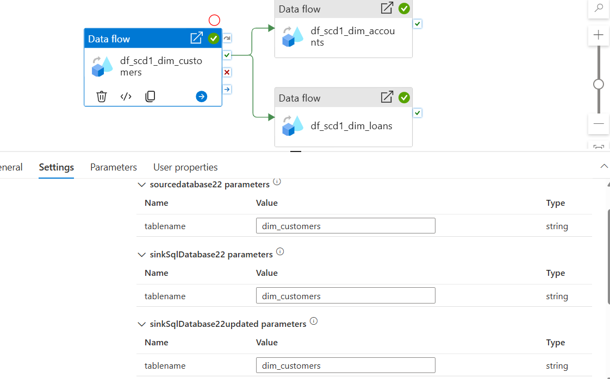
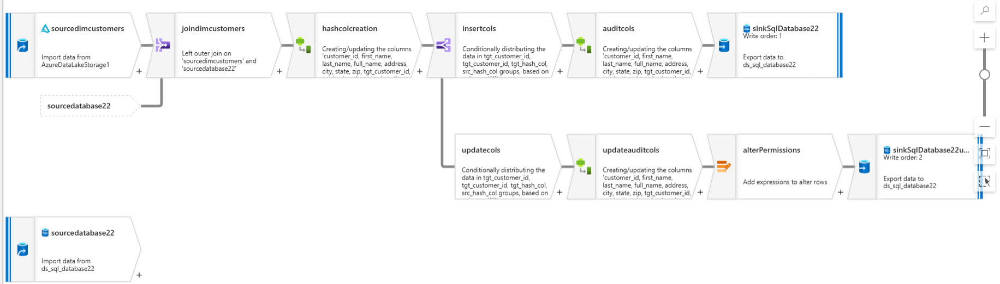
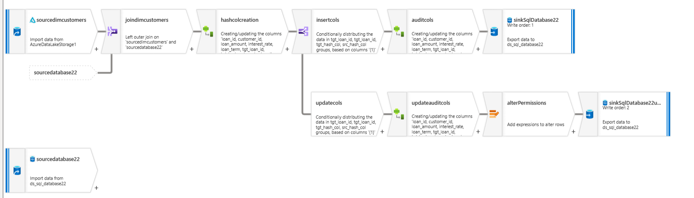
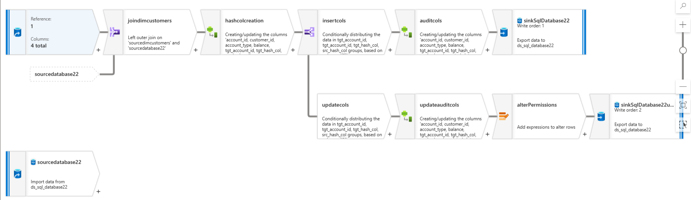
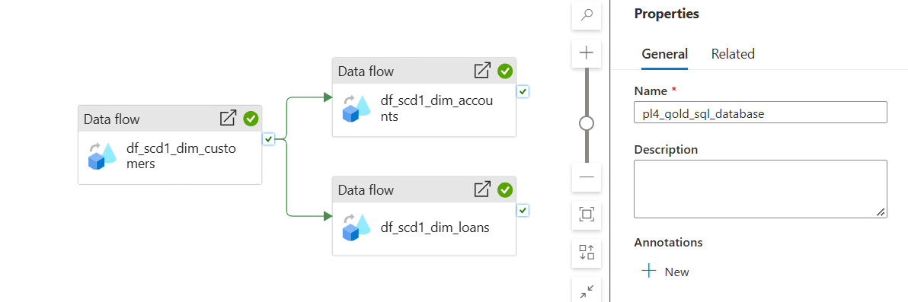

# Gold-to-Azure SQL with SCD 1 (Final loading)


## Summary
- p4 loads the 3 gold dimensions (customers, accounts, loans) from Delta files into **Azure SQL Database** tables using **SCD-1**: new rows are inserted, changed rows are overwritten, unchanged rows are left alone.
- Changes are detected by comparing a **hash** of each row's business columns with the hash already stored in SQL, so only rows that really changed get updated.
- One **parameterized SQL dataset** serves all three tables, and audit columns (`created_*`, `updated_*`) record who loaded each row and when.

---

## 1. What is SCD-1?
**SCD = Slowly Changing Dimension**: how we handle a dimension value that changes over time (e.g. a customer moves city).

| Type | What happens on a change | History kept? |
|---|---|---|
| **SCD-1** (used here) | Overwrite the old value | No, only the latest value |
| SCD-2 (enhancement) | Close the old row, insert a new row with dates/current flag | Yes, full history |

**Decision:** SCD-1 for all three dims now. SCD-2 for `dim_customer` address fields (address, city, state, zip) is a planned enhancement; names stay SCD-1.

---

## 2. SQL tables
Created by hand in SSMS.

| Table | Primary key | Business columns | Audit / helper columns |
|---|---|---|---|
| `dbo.dim_customers` | `customer_id` | first_name, last_name, full_name, address, city, state, zip | `hash_col`, `Created_by`, `Created_date`, `Updated_by`, `Updated_date` |
| `dbo.dim_accounts` | `account_id` | customer_id, account_type, balance | same |
| `dbo.dim_loans` | `loan_id` | customer_id, loan_amount, interest_rate, loan_term | same |

Audit column names are capitalised in SQL (`Created_by`, `Created_date`, `Updated_by`, `Updated_date`), and the sink output names were capitalised the same way so they match exactly.

Good practices used: a primary key on every table, `DATETIME2` for dates, `DECIMAL(18,2)` for money, `DECIMAL(5,2)` for rates.

---

## 3. The SCD-1 data flow (one per dimension)

```
gold dim (Delta) ──┐
                   ├─ Join (left outer on key) ─ Derived (hash) ─ Conditional split ─┬─ Inserts ─ Derived (audit) ─────────────────── Sink (allow insert)
SQL table (tgt_) ──┘                                                                 └─ Updates ─ Derived (audit) ─ Alter Row (update) ─ Sink (allow update)
                                                                       (unchanged rows go to the default stream and are dropped)
```


### 3.1 Sources
| Source | Type | Notes |
|---|---|---|
| Gold dim | Inline Delta, container `gold` | Import schema |
| Existing SQL table | Parameterized SQL dataset | Columns renamed with a `tgt_` prefix so they don't clash with gold columns after the join |

### 3.2 Join
**Left outer** join gold → SQL on the key (`customer_id`, `account_id` or `loan_id`). Every gold row is kept; if it isn't in SQL yet, all `tgt_` columns are null.

### 3.3 Hash (change detection)
A **Derived column** builds `src_hash_col` from the business columns. In the sink it is mapped to the SQL column `hash_col`, and the existing SQL value comes back as `tgt_hash_col`.

| Dimension | Hash expression |
|---|---|
| dim_customers | `crc32(first_name, last_name, full_name, address, city, state, zip)` |
| dim_accounts | `crc32(customer_id, account_type, balance)` |
| dim_loans | `crc32(customer_id, loan_amount, interest_rate, loan_term)` |
| Include | Exclude |
|---|---|
| Descriptive columns | The **primary key** (it's the join key, it never changes) |
| **Foreign keys** like `customer_id` in accounts/loans (if an account moves to another customer, that *is* a change) | **Audit columns** (they change every load and would make every row look "changed") |

> **crc32 vs sha2:** `crc32` gives a short number and is fine for a small dataset, but different rows can occasionally produce the same value (a *collision*), so a real change could be missed. Production pipelines usually use `sha2(256, ...)`, stored in `VARCHAR(64)`.

### 3.4 Conditional split (first matching condition wins)
| Stream | Condition | Meaning |
|---|---|---|
| Inserts | `isNull(tgt_customer_id)` | Not in SQL yet |
| Updates | `!isNull(tgt_customer_id) && (isNull(tgt_hash_col) \|\| tgt_hash_col != toString(src_hash_col))` | In SQL, and the data changed |
| Default | (everything else) | Unchanged, not written anywhere |

The `isNull(tgt_hash_col)` part makes the update check **null-safe**: in data flows, `null != 'abc'` is not `true`, so a row with a missing hash would otherwise be skipped forever.

### 3.5 Insert branch
| Column | Value |
|---|---|
| `created_by`, `updated_by` | `$pipeline_name` (data flow parameter) |
| `created_date`, `updated_date` | `currentTimestamp()` |

Sink: **Allow insert** only.

### 3.6 Update branch
| Column | Value |
|---|---|
| `updated_by` | `$pipeline_name` |
| `updated_date` | `currentTimestamp()` |
| `created_by`, `created_date` | **not mapped**, so SQL keeps the original values |

**Alter Row:** `Update if` `true()`. Sink: **Allow update**, key column = the primary key.

> A sink can only update, upsert or delete rows that an **Alter Row** has marked. Without it you get: *"Allowing delete, upsert, or update requires an Alter Row transformation"*.

### 3.7 Sink ordering
**Custom sink ordering** is turned on (data flow → Settings) so the two sinks write in a fixed order instead of at the same time.

| Order | Sink |
|---|---|
| 1 | Insert sink |
| 2 | Update sink |

---

## 4. One parameterized SQL dataset
Instead of 3 datasets, one dataset serves every table.

| Where | Setting |
|---|---|
| Dataset | `ds_sql_database22` (database `database22`) |
| Dataset → Parameters | `tablename` (String) |
| Dataset → Connection | Schema `dbo` (no dot!), Table `@dataset().tablename` |
| Pipeline → Data flow activity → Settings | `tablename` for the SQL source and both sinks, e.g. `dim_customers` |
| Debug | Debug Settings → Parameters → dataset parameters |

**Dataset parameter vs data flow parameter:** a data flow's own `$` parameters can't be used inside a dataset. The dataset parameter is filled in from **outside** the data flow (by the pipeline or debug settings).



---

## df_scd1_dim_customers :



## df_scd1_dim_loans :



## df_scd1_dim_accounts: 




## 5. Pipeline p4
```
df_scd1_dim_customers ──┬──► df_scd1_dim_accounts
                        └──► df_scd1_dim_loans
```
- Customers first, then accounts and loans in parallel (On success arrows).
- Each Data flow activity passes `@pipeline().Pipeline` into `$pipeline_name`, so SQL shows which pipeline loaded the row (the p4 pipeline is named `pl4_gold_sql_database`).
- Sink **Table action = None**: the tables are created by hand, and "Recreate table" would drop the primary keys every run.


