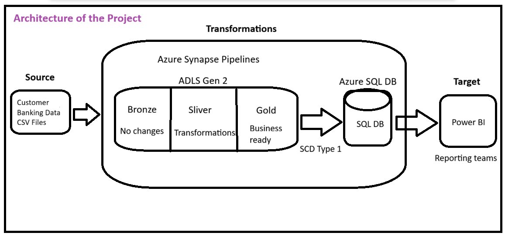
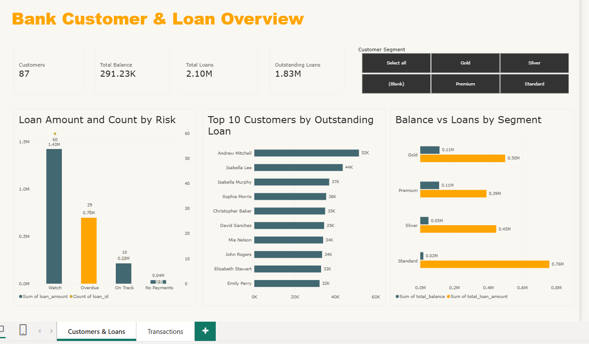
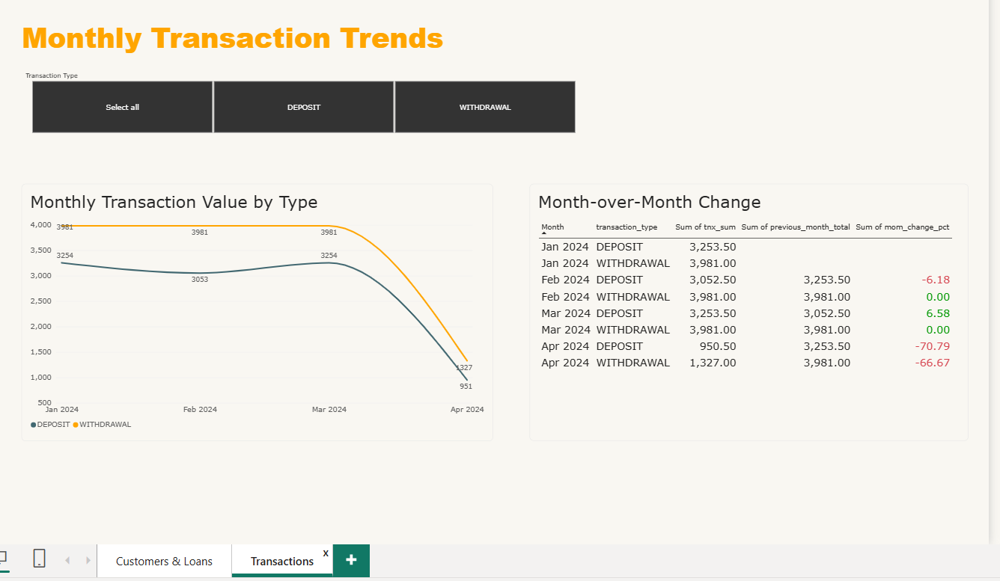

# Data Pipeline for Customer Account Analysis

## Project Overview
This project implements an end-to-end data pipeline to process bank customer, account, loan, payment and transaction data using Microsoft Azure services. Raw CSV files are moved through a medallion architecture (Bronze → Silver → Gold) as Delta tables on ADLS Gen2. The data is then loaded into Azure SQL Database with SCD Type 1 logic and reported in Power BI.

## Objectives
- Ingest source CSV files into Azure Data Lake Storage (Bronze layer).
- Clean and transform data using Azure Synapse pipelines and mapping data flows.
- Prepare curated and business-ready data in Silver and Gold layers.
- Load data into Azure SQL Database using SCD Type 1 upsert logic.
- Build a Power BI dashboard for customer account analysis.
- Secure credentials using Azure Key Vault.

## Technologies Used
- Azure Synapse Analytics (pipelines and mapping data flows)
- Azure Data Lake Storage Gen2 (ADLS Gen2), Delta format
- Azure SQL Database
- Azure Key Vault
- Power BI Desktop
- Git and GitHub

## Source Files
- accounts.csv
- customers.csv
- loans.csv
- loan_payments.csv
- transactions.csv

## Pipeline Architecture
Source CSV Files → Bronze (Raw) → Silver (Cleaned) → Gold (Business-Ready) → Azure SQL Database → Power BI

| Pipeline | What it does |
|---|---|
| p0 (master) | Runs p1 → p2 → p3 → p4 in order (Execute Pipeline, wait on completion) |
| p1 | Copies the 5 CSV files from source to **Bronze**, driven by a config file (ForEach) |
| p2 | One generic data flow cleans each file (dedupe, null keys, schema) and writes **Silver** Delta |
| p3 | Builds the **Gold** star schema (3 dims, 2 facts) and 3 business marts |
| p4 | Loads Gold into **Azure SQL**: SCD Type 1 for the dims, full refresh for the marts |

## Project Architecture

## Implementation Steps
1. Data ingestion from source storage into Bronze.
2. Data cleaning and validation in Silver.
3. Data transformation and Gold layer preparation.
4. SCD Type 1 upsert into Azure SQL Database.
5. Data validation and testing.
6. Power BI dashboard creation.

## Power BI Dashboard

**Future enhancements**
- SCD Type 2 for customer address history.
- Inferred members for orphan loans/accounts, so foreign keys can be restored.
- Schedule trigger with retries on the master pipeline (p0).
- Private endpoints for SQL and Key Vault instead of public access with a firewall.

## Key Learnings
- **Idempotency matters:** a silver sink set to append (not overwrite) duplicated rows on every run and broke the SCD-1 updates. Every layer now uses Overwrite, so reruns are safe.
- **SCD Type 1 with a hash:** comparing a CRC32 hash of the business columns detects changed rows cheaply. Unchanged rows are skipped, and `created_*` audit columns are never overwritten.
- **Column names must match exactly:** sink columns that didn't match SQL (e.g. `src_hash_col` vs `hash_col`) were silently dropped and loaded as NULL.
- **Data quality shows up in reports:** orphan loans (customer IDs missing from the customer table) forced the SQL foreign keys to be dropped, and they appear as "(Blank)" in Power BI.
- **Security:** the SQL password lives in Azure Key Vault, read by Synapse through its managed identity with least-privilege RBAC roles.
- **Verify in the target:** SQL row counts and audit dates are the source of truth, not the pipeline preview.